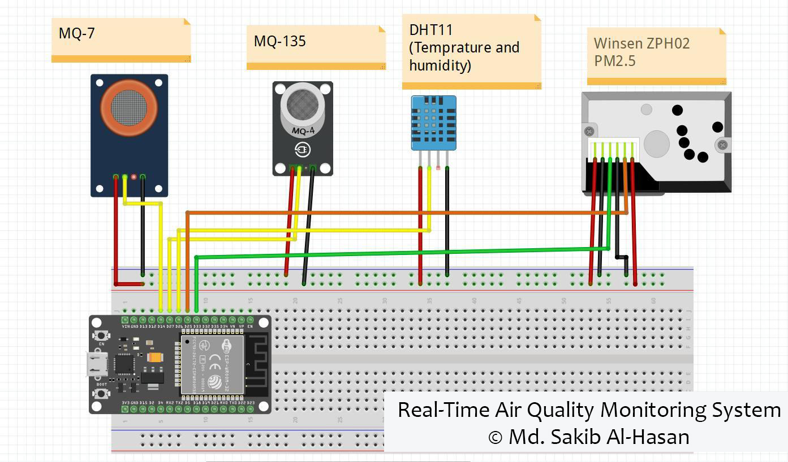
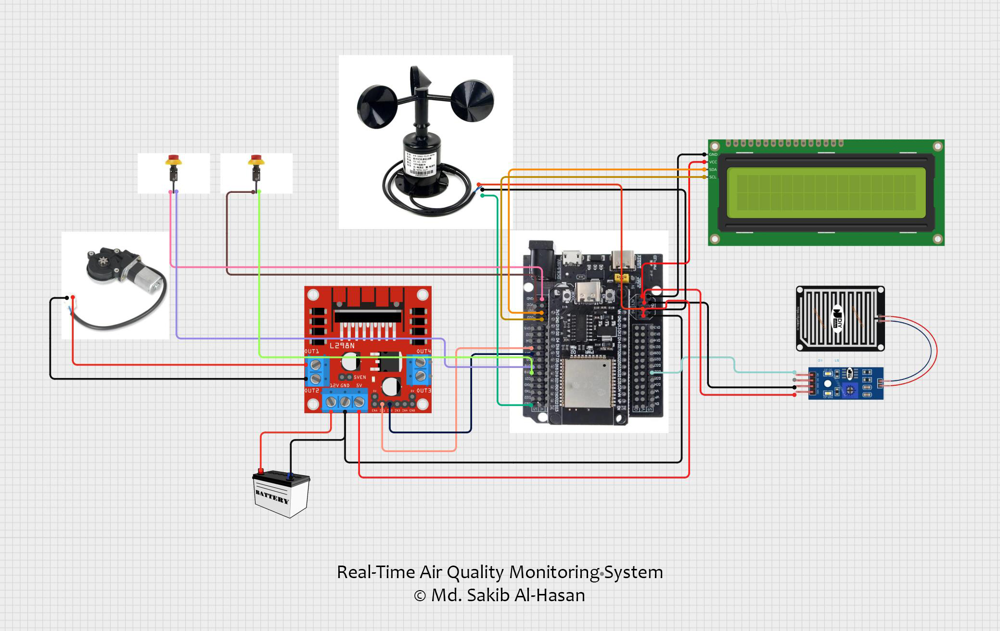

markdown
<div align="center">

# 🌦️ Real-Time Air Quality Monitoring System

### IoT-Based Environmental Monitoring • ESP32 • Blynk • Machine Learning

<p>
  An IoT-based environmental monitoring system that combines
  <b>ESP32 hardware, environmental sensors, Blynk cloud monitoring,
  and machine learning</b> to observe real-time environmental conditions.
</p>

### Designed & Developed by Md. Sakib Al-Hasan

<p>
  
  
  
  
  
</p>

</div>

---

# 📌 Project Overview

The **Real-Time Air Quality Monitoring System** is an IoT and machine-learning based environmental monitoring project designed to collect and display real-time environmental data through an ESP32-powered hardware system.

The system monitors:

- 🌫️ Dust density
- 🌡️ Temperature
- 💧 Humidity
- 🌬️ Wind speed
- 🌧️ Rain-related environmental conditions

Sensor readings are displayed locally through a **20×4 I2C LCD** and transmitted over Wi-Fi to **Blynk Cloud** for remote monitoring.

The project also includes a **Python machine-learning workflow** using an Australian weather dataset to analyze environmental patterns and predict the `RainTomorrow` target.

---

# 🎯 Project Objective

The main objective is to demonstrate how **embedded systems, IoT connectivity, cloud monitoring, data analysis, and machine learning** can be combined into a single environmental monitoring solution.

### Core Goals

- Build an ESP32-based environmental monitoring device
- Collect multiple environmental measurements
- Display readings locally through an LCD
- Send sensor data to Blynk Cloud
- Analyze environmental data using Python
- Apply PCA and machine-learning classification
- Explore rainfall prediction from historical weather data

---

# ✨ Key Features

```text
📡 Real-Time Environmental Monitoring
🌫️ Dust Density Measurement
🌡️ Temperature Monitoring
💧 Humidity Monitoring
🌬️ Wind Speed Monitoring
🌧️ Rain Sensor Integration
📟 20×4 I2C LCD Display
☁️ Blynk Cloud Connectivity
📊 Remote IoT Monitoring
🧠 PCA-Based Data Analysis
🤖 Machine-Learning Classification
📈 RainTomorrow Prediction
🔌 ESP32 Wi-Fi Communication
```

---

# 🏗️ System Architecture

```text
                         ┌──────────────────────┐
                         │   Environmental      │
                         │      Sensors         │
                         └──────────┬───────────┘
                                    │
            ┌───────────────────────┼───────────────────────┐
            │                       │                       │
        Dust Sensor              DHT11               Rain Sensor
            │               Temperature/Humidity          │
            │                       │                       │
            └───────────────────────┼───────────────────────┘
                                    │
                           ┌────────▼────────┐
                           │      ESP32      │
                           │ Microcontroller │
                           └───────┬─────────┘
                                   │
                     ┌─────────────┴─────────────┐
                     │                           │
                ┌────▼─────┐               ┌────▼─────┐
                │ 20×4 LCD │               │   Wi-Fi  │
                │  Display │               │Connection│
                └───────────┘               └────┬─────┘
                                                  │
                                           ┌──────▼──────┐
                                           │ Blynk Cloud │
                                           └─────────────┘


        Historical Weather Dataset
                    │
                    ▼
             ┌─────────────┐
             │ Data Cleaning│
             └──────┬──────┘
                    │
                    ▼
             ┌─────────────┐
             │     PCA     │
             └──────┬──────┘
                    │
                    ▼
          ┌─────────────────────┐
          │ ML Classification   │
          │ Models              │
          └──────────┬──────────┘
                     │
                     ▼
              RainTomorrow
                 Prediction
```

### Architecture Principle

**Sense → Process → Display → Connect → Monitor → Analyze → Predict**

---

# 🛠️ Technologies & Components

## 🔌 Hardware

| Component | Purpose |
|---|---|
| **ESP32** | Main microcontroller and Wi-Fi communication |
| **Dust Sensor** | Measures dust density |
| **DHT11** | Measures temperature and humidity |
| **Rain Sensor** | Detects rainfall/environmental conditions |
| **Wind-Speed Sensor** | Measures wind speed |
| **20×4 I2C LCD** | Local real-time data display |

---

## 💻 Software & Platforms

| Technology | Usage |
|---|---|
| **Arduino C/C++** | ESP32 embedded programming |
| **Blynk** | IoT cloud monitoring |
| **Python** | Data analysis and machine learning |
| **Jupyter Notebook** | ML experimentation |
| **Pandas** | Dataset processing |
| **NumPy** | Numerical computation |
| **scikit-learn** | Machine-learning models |
| **PCA** | Feature analysis and dimensionality reduction |

---

# 🔄 System Workflow

```text
1. Environmental sensors collect physical measurements
                         ↓
2. ESP32 reads and processes sensor values
                         ↓
3. Readings are displayed on the 20×4 LCD
                         ↓
4. ESP32 connects to Wi-Fi
                         ↓
5. Sensor data is transmitted to Blynk Cloud
                         ↓
6. Environmental conditions can be monitored remotely
                         ↓
7. Historical weather data is processed separately
                         ↓
8. PCA and ML models analyze weather patterns
                         ↓
9. Models predict the RainTomorrow target
```

---

# 📊 Monitored Information

| Parameter | Source | Output |
|---|---|---|
| 🌫️ Dust Density | Dust Sensor | Local + Blynk |
| 🌡️ Temperature | DHT11 | Local + Blynk |
| 💧 Humidity | DHT11 | Local + Blynk |
| 🌬️ Wind Speed | Wind Sensor | Local + Blynk |
| 🌧️ Rain Condition | Rain Sensor | Hardware monitoring |
| ☁️ Cloud Data | Blynk | Remote monitoring |

---

# 🧠 Machine Learning

The project contains a separate machine-learning workflow using an **Australian weather dataset**.

The workflow includes:

```text
Weather Dataset
      ↓
Data Preparation
      ↓
Feature Processing
      ↓
PCA
      ↓
Train/Test Split
      ↓
Multiple Classification Models
      ↓
Cross-Validation
      ↓
RainTomorrow Prediction
```

## 🤖 Evaluated Models

| Model | Test Accuracy | Mean CV Accuracy |
|---|---:|---:|
| Random Forest | 100% | ~99.30% |
| Logistic Regression | ~98.90% | ~95.59% |
| SVM | ~94.99% | ~82.59% |
| KNN | ~86.15% | ~70.86% |
| Decision Tree | 100% | ~99.99% |

> **Note:** These are experimental results reported by the notebook. They should not be interpreted as production-level predictive performance without independent validation and additional testing.

---

# 📸 Project Showcase

## 🧩 Hardware Overview 01

<p align="center">
  
</p>

---

## 🧩 Hardware Overview 02

<p align="center">
  
</p>

---

## 📡 Monitoring Prototype 01

<p align="center">
  
</p>

---

## 📡 Monitoring Prototype 02

<p align="center">
  
</p>

---

# 🔌 Hardware-to-Cloud Pipeline

```text
Environmental Sensors
        │
        ▼
      ESP32
        │
        ├──────────────► 20×4 I2C LCD
        │                 Local Display
        │
        ▼
       Wi-Fi
        │
        ▼
   Blynk Cloud
        │
        ▼
 Remote Monitoring
```

This architecture demonstrates a complete **IoT sensing-to-cloud workflow** using an ESP32 as the central embedded controller.

---

# 🌐 IoT Monitoring Concept

The system demonstrates how physical environmental measurements can be transformed into remotely accessible digital information.

### Sensor Layer
Collects environmental measurements.

### Processing Layer
ESP32 reads and processes sensor values.

### Communication Layer
Wi-Fi provides connectivity between the ESP32 and Blynk.

### Cloud Layer
Blynk provides remote monitoring of transmitted values.

### Analytics Layer
Python and machine learning are used for historical environmental-data analysis.

---

# 💡 Potential Applications

- 🏠 Smart Home Environmental Monitoring
- 🏫 Educational IoT Laboratories
- 🌱 Environmental Observation
- 🌾 Smart Agriculture
- 🏭 Industrial Environment Monitoring
- 🌦️ Weather Observation Systems
- 🏙️ Smart-City Environmental Projects

---

# 🎓 Engineering Concepts Demonstrated

- Embedded Systems
- ESP32 Microcontroller Programming
- Sensor Integration
- I2C Communication
- Wi-Fi Communication
- IoT Cloud Integration
- Real-Time Monitoring
- Environmental Data Collection
- Data Preprocessing
- Principal Component Analysis
- Machine Learning Classification
- Cross-Validation
- Hardware–Software Integration

---

# 📁 Repository Structure

```text
Real-Time-Air-Quality-Monitoring-System/
│
├── README.md
├── Info.txt
│
├── src/
│   ├── arduino/
│   │   └── arduino Code VS.cpp
│   │
│   └── machine-learning/
│       └── Final_Code.ipynb
│
├── data/
│   └── Weather Station Dataset.csv
│
└── docs/
    └── screenshots/
        ├── 01-hardware-overview.jpg
        ├── 02-monitoring-prototype.jpg
        ├── 03-blynk-monitoring.jpg
        └── 04-environmental-monitoring.jpg
```

---

# 🔐 Security Note

Sensitive credentials should **never** be committed to a public repository.

The Arduino source uses placeholders for:

```cpp
#define BLYNK_AUTH_TOKEN "YOUR_BLYNK_AUTH_TOKEN"

char ssid[] = "YOUR_WIFI_SSID";
char pass[] = "YOUR_WIFI_PASSWORD";
```

Always use your own credentials locally and keep private tokens and passwords outside public source code.

---

# 🚀 Future Improvements

- 📈 Historical sensor-data storage
- 📊 Advanced environmental dashboards
- 🔔 Threshold-based alerts
- 📱 Dedicated mobile monitoring application
- 🗺️ Location-based environmental monitoring
- 🤖 Improved weather prediction models
- ☁️ More advanced cloud analytics
- 🔋 Portable battery-powered deployment

---

# 👨‍💻 Developer

<div align="center">

## Md. Sakib Al-Hasan

### Software Developer | Full-Stack Developer | Backend Developer

**B.Sc. in Computer Science & Engineering**

<br>

[](https://www.linkedin.com/in/r-talukder66/)
[](https://github.com/sakib-rone66)
[](mailto:info.sakib.bluesec@gmail.com)

</div>

---

<div align="center">

### 🌍 Real-Time Monitoring • ☁️ IoT Connectivity • 🧠 Intelligent Analysis

**Designed & Developed by Md. Sakib Al-Hasan**

<br>

⭐ If you find this project interesting, consider giving the repository a star.

</div>
